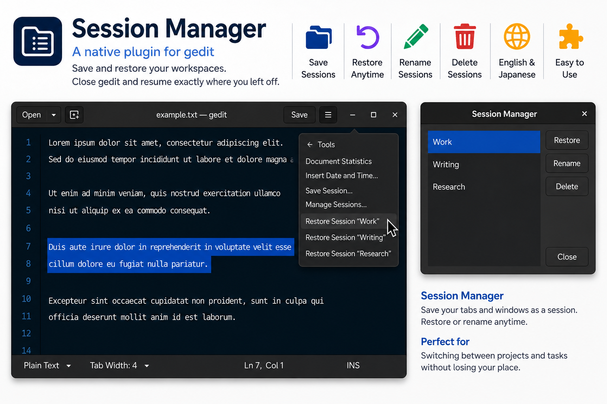

# Session Manager

A plugin for saving and restoring sessions in gedit.

It automatically restores the files that were open before gedit was closed, and also lets you save and manage multiple named sessions.

Designed for **gedit 48.2 and later**. Currently, the plugin has been tested on **gedit 50**.



🇯🇵 日本語ドキュメント: [README_ja.md](README_ja.md)

## Features

- Automatically restores the files that were open before gedit was closed.
- Saves the currently open files as a named session.
- Updates an existing saved session with the files that are currently open.
- Restores saved sessions.
- Renames saved sessions.
- Deletes saved sessions.
- Restores the order of files saved in a session.
- Restores saved sessions directly from the gedit menu.
- Opens the session management dialog with the **Ctrl+R** keyboard shortcut.
- Supports English and Japanese.

## What is saved in a session

Session Manager records the open files that have been saved, along with their order.

Untitled documents that have never been saved are not included in sessions.

Display state such as the cursor position, selection, and scroll position is not saved.

`Previous Session` is a special session managed by Session Manager to automatically restore the state from the previous time gedit was closed. This name is reserved and cannot be used as a regular session name. It also cannot be renamed or deleted by the user.

## Saving and managing sessions

The following items are added to the gedit menu:

- **Save Session…**
- **Manage Sessions…**
- Items for directly restoring saved sessions

In **Save Session…**, you can enter a new session name or select an existing session from the drop-down list to update its contents.

In **Manage Sessions…**, you can restore, rename, and delete saved named sessions.

The following operations are also available in the management dialog:

- **Enter**: Restore the selected session
- **F2**: Rename the selected session
- Double-click: Restore the selected session

You can also open the session management dialog by pressing **Ctrl+R** in gedit.

## Installation

This release is intended for the **Flatpak version of gedit**.

It is designed for **gedit 48.2 and later**, but currently has only been tested on **gedit 50**.

Copy the following files to:

```text
~/.var/app/org.gnome.gedit/data/gedit/plugins/
```

- `libsessionmanager.so`
- `sessionmanager.plugin`

Restart gedit and enable **Session Manager** from the plugin list.

## Building from source

This repository contains the source code for the plugin.

Place the source directory under `plugins/` in the gedit source tree and build gedit.

## Session data

For the Flatpak version, session data is stored in:

```text
~/.var/app/org.gnome.gedit/data/gedit/plugins/sessionmanager/saved-sessions.xml
```

For details about the XML format and plugin behavior, see:

- `docs/SESSION_FORMAT.md`
- `docs/SESSION_BEHAVIOR.md`

The XML format follows the structure used by the legacy gedit Session Saver.

## Acknowledgements

Session Manager takes inspiration from the features and session format of the legacy **Session Saver** plugin that was included with gedit.

The XML format used for session data is designed with compatibility with the format used by the legacy Session Saver in mind.

Thanks to the developers who created and maintained Session Saver.

## License

This project is released under the MIT License. See LICENSE for details.
