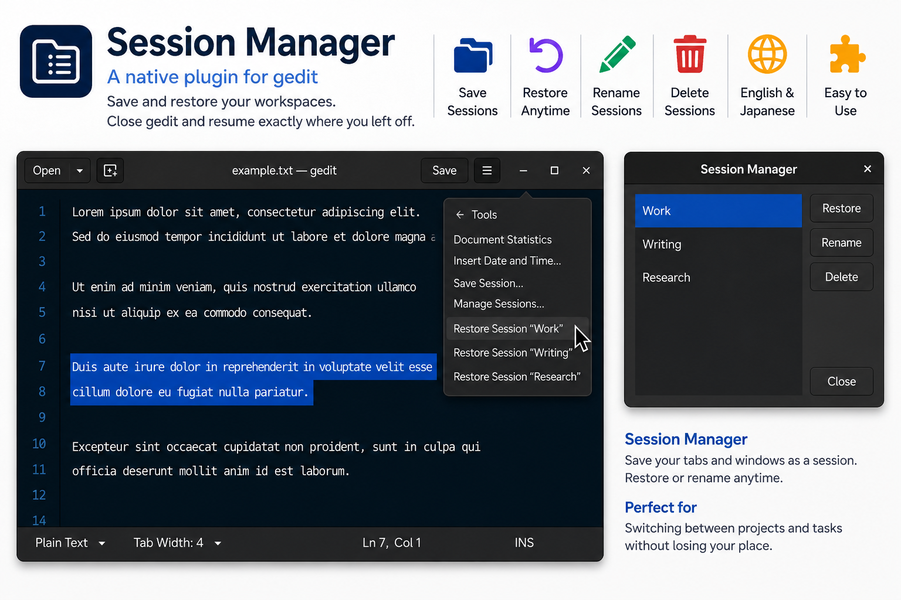

# Session Manager

geditのセッションを保存・復元するプラグインです。

geditを終了する前に開いていたファイルを次回起動時に自動復元するほか、名前を付けて複数のセッションを保存・管理できます。

**gedit 48.2以降**での動作を想定しています。現在、実機で動作を確認しているのは **gedit 50** です。

🇺🇸 English documentation: [README.md](README.md)



## 機能

- geditを終了する前に開いていたファイルを、次回起動時に自動復元します。
- 現在開いているファイルを、名前付きセッションとして保存できます。
- 保存済みのセッションを選択し、現在開いているファイルの構成で更新できます。
- 保存済みのセッションを復元できます。
- 保存済みのセッションの名前を変更できます。
- 保存済みのセッションを削除できます。
- セッションに保存したファイルの並び順を復元します。
- 保存済みのセッションはgeditのメニューから直接復元できます。
- キーボードショートカット **Ctrl+R** でセッション管理画面を開けます。
- 日本語と英語に対応しています。

## セッションに保存される内容

Session Managerは、開いている保存済みファイルと、その並び順をセッションとして記録します。

まだ一度も保存していない無題の文書は、セッションには含まれません。

カーソル位置、選択範囲、スクロール位置などの表示状態は保存しません。

`Previous Session` は、前回終了時の状態を自動復元するためにSession Managerが管理する特別なセッションです。この名前は予約されており、通常のセッション名として使用することはできません。また、ユーザーが名前を変更したり削除したりすることもできません。

## セッションの保存と管理

geditのメニューに、次の項目が追加されます。

- **セッションを保存…**
- **セッションを管理…**
- 保存済みセッションを復元する項目

「セッションを保存…」では、新しいセッション名を入力するほか、既存のセッションをプルダウンメニューから選択して内容を更新できます。

「セッションを管理…」では、保存済みの名前付きセッションの復元、名前の変更、削除ができます。

管理画面では、次の操作も使用できます。

- **Enter**：選択しているセッションを復元
- **F2**：選択しているセッションの名前を変更
- ダブルクリック：選択しているセッションを復元

セッション管理画面は、gedit上で **Ctrl+R** を押して開くこともできます。

## インストール

このリリースは **Flatpak版 gedit** を対象としています。

**gedit 48.2以降**での動作を想定していますが、現在、実機で動作を確認しているのは **gedit 50** です。

以下のファイルを

```text
~/.var/app/org.gnome.gedit/data/gedit/plugins/
```

へコピーしてください。

- `libsessionmanager.so`
- `sessionmanager.plugin`

geditを再起動し、プラグイン一覧から **Session Manager（セッション管理）** を有効にしてください。

## ソースコードからビルド

このリポジトリにはプラグインのソースコードが含まれています。

ソースディレクトリを gedit のソースツリー内 `plugins/` に配置し、geditをビルドしてください。

## セッションデータ

セッション情報は、Flatpak版では次のファイルに保存されます。

```text
~/.var/app/org.gnome.gedit/data/gedit/plugins/sessionmanager/saved-sessions.xml
```

XML形式や詳しい動作仕様については、以下の文書を参照してください。

- `docs/SESSION_FORMAT_ja.md`
- `docs/SESSION_BEHAVIOR_ja.md`

XML形式は、従来の gedit Session Saver で使われていた構造を引き継いでいます。

## 謝辞

Session Managerは、geditに付属していた従来の **Session Saver** の機能やセッション形式を参考にしています。

セッションデータのXML形式は、従来のSession Saverで使われていた形式との互換性を考慮しています。

Session Saverを開発・維持してきた開発者の皆さまに感謝します。

## ライセンス

このプロジェクトは MIT License のもとで公開しています。詳細は LICENSE をご覧ください。
